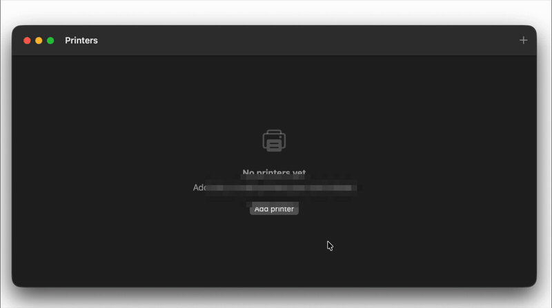

# bambu-swift

A Swift package for reading what a Bambu Lab printer is doing, over your
local network. No cloud account, no dependencies.

```swift
import BambuLAN

let printer = BambuPrinter(host: "192.168.1.143", serial: "01P00A000000000", accessCode: "12345678")
printer.start()
// printer.summary → "Printing benchy — 42 %"
```

I wrote it for a Mac menu bar app that shows my printer's status, and pulled
it out so other people can use it. It reads status only: job, progress,
layers, time left, temperatures, fans, filament and errors. It doesn't send
commands. Recent firmware ignores most commands from third-party apps unless
the printer is in LAN-only mode with Developer Mode on, so I left them out.

Not affiliated with Bambu Lab. It uses the local MQTT interface the printers
expose, as documented by the community.

## Try it

There's a small Mac app in `Examples/BambuMonitor`. Clone the repo and run:

```bash
swift run bambu-monitor
```

Click +, pick your printer from the list of printers found on the network,
type its access code, and it shows up with live status. You can also type the
details in by hand.



The printers you add are saved in a plain JSON file you can edit:

```
~/Library/Application Support/bambu-swift/printers.json
```

```json
[
  {
    "name": "Workshop",
    "host": "192.168.1.143",
    "serial": "01P00A000000000",
    "accessCode": "12345678"
  }
]
```

"Open printers file" in the app's menu shows it in Finder. The access code is
stored in plain text there, which is fine for trying things out; a real app
should keep it in the Keychain.

There's also a command-line version that reads the same file:

```bash
swift run bambu-status              # every printer in printers.json
swift run bambu-status --discover   # printers on the network, for 15 seconds
swift run bambu-status 192.168.1.143 01P00A000000000 12345678
```

## What you need from the printer

- IP address and access code: Settings → Network (WLAN) on the printer's
  screen. The access code is 8 characters.
- Serial number: Settings → Device, or let discovery find it.

Your Mac or iPhone has to be on the same network as the printer. LAN-only mode
isn't needed for reading status.

## Install

```swift
dependencies: [
    .package(url: "https://github.com/troglodisme/bambu-swift.git", from: "0.1.0"),
],
targets: [
    .target(name: "MyApp", dependencies: [
        .product(name: "BambuLAN", package: "bambu-swift"),
    ]),
]
```

Or in Xcode: File → Add Package Dependencies.

It has two libraries. Most apps want `BambuLAN`, which connects to printers
and includes everything else. `BambuCore` is only the parsing (MQTT packets,
printer reports, print history), with no networking, if you'd rather bring
your own.

macOS 14 or iOS 17, Swift 5.9.

## Use it

`BambuPrinter` is `@Observable`, so SwiftUI can read it directly:

```swift
struct PrinterView: View {
    @State private var printer = BambuPrinter(
        host: "192.168.1.143", serial: "01P00A000000000", accessCode: "12345678", name: "Workshop"
    )

    var body: some View {
        VStack(alignment: .leading) {
            Text(printer.name).font(.headline)
            Text(printer.status == .online ? printer.summary : printer.status.label)
            if let progress = printer.details.progress {
                ProgressView(value: progress, total: 100)
            }
        }
        .onAppear { printer.start() }
        .onDisappear { printer.stop() }
    }
}
```

Outside SwiftUI, set `onUpdate`:

```swift
printer.onUpdate = { update in
    print(summaryOf(update.details, online: update.online))
}
```

`printer.status` tells you where the connection is:

| Status | |
|---|---|
| `.connecting` | Opening the connection. |
| `.connected` | Access code accepted, waiting for the first report. |
| `.online` | Reports are coming in. |
| `.unreachable` | No answer, or the connection dropped. It tries again after 5 seconds, then less often, up to every 2 minutes. |
| `.authFailed` | Wrong access code. It stops trying, so the printer doesn't block it. |
| `.certificateChanged` | The printer's certificate changed. See below. |
| `.stopped` | You called `stop()`. |

`printer.lastError` has a sentence you can show when something's wrong.

### Finding printers

```swift
let discovery = BambuDiscovery { printer in
    print(printer.displayName, printer.model ?? "", printer.host, printer.serial)
}
discovery.start()
```

Printers announce themselves every few seconds on UDP port 2021. The callback
runs on a background queue. `DiscoveryTable` keeps a list without duplicates
and drops printers that go quiet for two minutes. If Bambu Studio is open on
the same Mac it may hold the port; connecting by IP still works.

### Certificates

The printers use self-signed certificates, so they can't be checked the
normal way. The package remembers the first certificate a printer shows, once
the access code is accepted, and refuses a different one after that. If you
replaced or reset the printer, call `printer.trustNewCertificate()`.

The fingerprints go in `UserDefaults`. Pass `pins: MemoryPinStore()` or your
own `CertificatePinStore` to keep them somewhere else.

### Print history

`JobTracker` turns updates into jobs with start, end, outcome and material:

```swift
var tracker = JobTracker()
printer.onUpdate = { update in tracker.update(update) }
```

`PrintJob` is `Codable`, so you can save the list between launches.

### Lower down

`MQTTSession` is just the TLS connection, if you want the raw messages.
`BambuCore` has the packet codec (`MQTT`, `MQTTDecoder`), the report parser
(`mergeReport`, `toPrinterDetails`) and the printer's topics (`BambuMQTT`).

## App permissions

On iOS, and on macOS 15 or later, add `NSLocalNetworkUsageDescription` to your
Info.plist. Sandboxed Mac apps need Outgoing Connections, and Incoming
Connections too if you use discovery.

## Printers

I've tested it on a P2S. The X1 Carbon, X1, X1E, P1P, P1S, A1 mini, A1, H2D and
H2S use the same interface and their model codes are recognised, but I haven't
tried them. If you have one, let me know how it goes.

## Licence

MIT. See [LICENSE](LICENSE).
